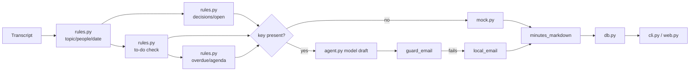

# JiYao · Meeting Notes from Transcripts

[](https://github.com/wushiyi105-jpg/jiyao/actions) []() [](./LICENSE) [](https://codecov.io/gh/wushiyi105-jpg/jiyao)


> Paste a transcript: get decisions, to-dos, the questions nobody settled, and a follow-up email you can send as is.

Transcription tools produce text, but nobody wants to pick "what was actually decided", "who promised what" and "which question got skipped" out of two hours of speech. This tool turns that into structure: every decision carries its original sentence and speaker; every to-do is checked for action, owner and due date, with the missing field flagged; vague words and incomplete items feed the next agenda.

**CLI + Web, zero third-party dependencies.**

## ✨ Features

- ✅ **Decision vs discussion** — only sentences with 定了 / 拍板 / 通过 / 同意 and without 待定 / 下次再说 count, each with its speaker
- 📌 **Three-part to-do check** — action, owner, due, dependency; missing ones are labelled, not hidden
- ⏳ **Open questions** — 下次再说 / 再看看 / 没有结论 become a separate list, rewritten as questions to settle
- 🟡 **Vague-word count** — 尽快 / 回头 / 看看 / 之后 counted per word; vague means no deadline
- 🗓 **Next agenda** — open questions + overdue to-dos + to-dos without a due date
- 📄 **Follow-up email** — conclusions, to-do table, items to settle; model drafts must pass date and number checks or the local template takes over
- 🧮 **Dates parsed locally** — `2026-11-24`, `11月24日`, `明天`, `本周五`, `下周三`, `月底` all resolve to real dates
- 🔒 **The model cannot invent numbers** — dates and amounts in the email must come from the transcript, or the whole draft is rejected

## 🚀 Quick start

```bash
git clone https://github.com/wushiyi105-jpg/jiyao.git
cd jiyao

cp .env.example .env      # optional: LLM_API_KEY

python -m jiyao minutes --file transcript.txt
```

The format is forgiving: one `Name: text` per line, and `[00:12] Name: …` also works.

Docker:

```bash
docker build -t jiyao .
docker run -p 8000:8000 jiyao
```

## 🤔 Why not just let a model summarise

A general model returns a polished paragraph about the login redesign, the API doc and the tracking plan, but it will not tell you that Li Si's to-do has no deadline. Four differences:

1. **Dates are computed, not guessed** — `rules.dates_in()` maps 明天 to `2026-11-25` relative to the meeting date (not today), 本周五 from Monday, 月底 to the last day of the month. Models often anchor relative dates to "now", shifting every deadline by a week.
2. **Completeness is checked** — "接口文档我明天发出来" has an action, an owner and a due date, so it is ✅. "数据看板尽快看一下" has action and owner but no deadline, so it is flagged ⚠️ and pushed into the next agenda. That is the `missing` field from `rules.todos()`, not wording.
3. **Vague words are counted** — 尽快 once, 再说 once, straight from `rules.vague_hits()`. Vagueness is a scheduling risk, not a tone issue.
4. **The email cannot fabricate** — `agent.guard_email()` compares every date and number in a model draft against local extraction; an unauthorised `2026-12-01` or `8800` rejects the draft and the local template rewrites it.

## 🎯 Use cases

- **Weekly sync**: one hour, ten to-dos, minutes in five minutes, and you can see who has no deadline.
- **Design review**: conclusions and leftovers separated, failed items assigned.
- **Retro**: goals, results, problems, improvements.
- **Client call**: client asks vs our answers, our to-dos vs items awaiting the client.
- **Remote/async**: paste the transcript instead of replaying the recording.

## 🗺 Roadmap

- **Merge segments**: stitch multi-part transcripts by timestamp and deduplicate.
- **Speaker correction**: rename a merged speaker once and update every reference.
- **Status write-back**: `done` / `blocked`, plus each person's open items in history.
- **Calendar export**: `.ics` from due dates.
- **Custom templates**: derive weekly/review templates from `data/meeting.json`.

## ❓ FAQ

**The transcript is spoken language with no punctuation.**
Sentences are split on `[。！？；\n]` and attributed by speaker. A block without speakers still works, though owner detection is weaker — pass `--participants` to help.

**Can the model misread 明天?**
No. Relative dates are resolved locally against the meeting date; the model receives the concrete `2026-11-25` and the email is validated again.

**Is 下周再说 a to-do or an open question?**
An open question. Anything hitting a suspension marker stays out of the to-do table, so you never get a to-do that can never be due.

**Does it detect amounts?**
It extracts numbers (`rules.numbers()`) only to check whether a model invented one; there is no cost accounting here.

**What is missing offline?**
Only the wording of the summary and task hints. Decisions, to-dos, open questions, agenda and the email are all produced, with identical structure.

## 📖 Commands

```bash
# 📝 full minutes
python -m jiyao minutes --file transcript.txt
python -m jiyao minutes --text "Li Si: I'll send the API doc tomorrow." --topic "Weekly" --date 2026-11-24

# 📌 to-dos only
python -m jiyao todos --file transcript.txt

# 📄 email only
python -m jiyao email --file transcript.txt

# 🗓 agenda only
python -m jiyao agenda --file transcript.txt

# 🗂 history
python -m jiyao history

# 🌐 web
python -m jiyao web --port 8000

python -m jiyao --json minutes --file transcript.txt
python -m jiyao --mock minutes --file transcript.txt
```

## 🔌 Model configuration

Any **OpenAI-style `/chat/completions`** endpoint:

| Platform | `LLM_BASE_URL` | `LLM_MODEL` |
|---|---|---|
| DeepSeek (default) | `https://api.deepseek.com` | `deepseek-flash` |
| OpenAI | `https://api.openai.com/v1` | `gpt-4o-mini` |
| Local Ollama | `http://localhost:11434/v1` | `qwen2.5` |

## 🧠 How it works

```
transcript + topic + participants + meeting date
  │
  ├─ rules.parse_header ── topic / participants / date
  ├─ rules.people ──────── speakers + roster alignment
  ├─ rules.dates_in ────── relative → concrete dates
  ├─ rules.decisions ───── decisions (suspension excluded)
  ├─ rules.suspended ───── open questions
  ├─ rules.todos ───────── action / owner / due / dependency / missing
  ├─ rules.overdue ─────── past due
  ├─ rules.agenda ──────── open + overdue + missing due
  │
  ├─ model: summary / hints / risks / email (guard_email)
  └─ offline: mock.py same-shape draft + local email
  │
  └─ SQLite → CLI / Web
```

### Data flow



## 🗂 Layout

```
jiyao/
├── jiyao/
│   ├── rules.py    # dates, people, decisions, open questions, to-dos, agenda
│   ├── agent.py    # orchestration + email date/number guard
│   ├── mock.py     # offline same-shape draft
│   ├── db.py       # meetings and to-dos
│   ├── cli.py      # minutes / todos / email / agenda / history / web
│   └── web.py      # single page + JSON API
├── data/meeting.json   # 4 templates + verbs + vague words + markers
├── tests/test_jiyao.py
└── assets/demo.gif
```

## ✅ Tests

```bash
python -m unittest discover tests -v
```

28 tests: header parsing, speakers, five date forms, decision/open recall, to-do completeness, dependencies, vague words, overdue, agenda, template match, Markdown sections, offline shape, and email guards rejecting invented dates and amounts. CI runs on 3.10/3.11/3.12.

## 👤 Author

shiyi · GitHub [@wushiyi105-jpg](https://github.com/wushiyi105-jpg) · [wushiyi105@gmail.com](mailto:wushiyi105@gmail.com)

## 📄 License

[MIT](./LICENSE)
