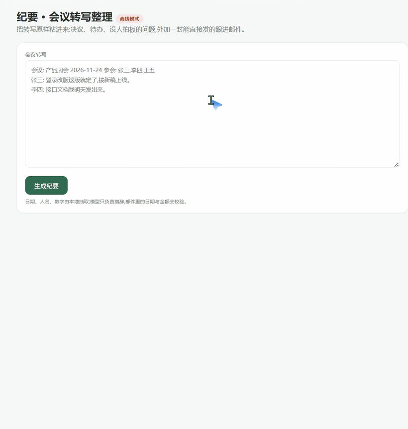
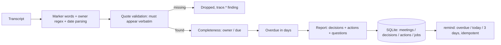

# jiyao · meeting notes and decision tracking



The meeting ends; what each person promised, by when, and whether it shipped — nothing gets lost.

## Features

- **Traceable to the source**: every decision and action carries a verbatim quote and character offset; `trace.decision` / `trace.action` drops anything that cannot be found.
- **Three buckets**: decisions, action items, open questions, each tracked apart.
- **Completeness checks**: `action.no_owner` for a missing owner, `action.no_due` for a missing deadline — recorded, not blocked.
- **Overdue tracking**: open items past their due date are counted in days; over 7 days is severity=high.
- **Daily reminder**: `remind` summarises overdue / due-today / due-in-3-days; the `jobs` table makes it idempotent — one per day.
- **Works offline**: rules only when there is no API key; a model can fill implicit items, and those still pass quote validation.

## Quick start

```bash
uv sync --extra dev
uv run jiyao digest --file meeting.txt --save --title "Payment review"
uv run jiyao actions
uv run jiyao remind
uv run jiyao serve        # http://127.0.0.1:8000
```

Measured on that transcript ("host: let's settle the payment flow… Li: I'll finish the verification script next Wednesday"): 1 decision, 1 action, owner Li, due 2026-12-02 (the meeting was Friday 2026-11-27, "next Wednesday").
26 tests, 80% line coverage.

## Why not just ask a general model

A general model can produce minutes too, but:

1. **It doesn't keep the source** — it rewrites, merges, and invents "everyone agreed";
2. **It doesn't track** — the output is finished, nobody knows next week whether it shipped;
3. **It doesn't flag gaps** — an owner-less action goes unmentioned;
4. **It never reminds you** — no due dates, no overdue.

Here every decision and action must be found verbatim in the transcript, or it is dropped; tracking, overdue and reminders stay in local code.

## Who it's for

- People in three or more meetings a week;
- People who forward minutes and get asked about progress;
- Project leads who chase delivery dates.

## Roadmap

- [ ] Dependencies between decisions (B cannot start before A)
- [ ] Cross-meeting threads for the same item
- [ ] Read titles and attendees from the calendar
- [ ] Markdown weekly export

## FAQ

**What if it misses something?**
Rules only read markers ("decided / confirmed") plus explicit owner+date patterns. Say it plainly, or enable the model — model output still passes quote validation. Missing beats inventing.

**Will `remind` send twice?**
No. The key is `remind:<date>` in the `jobs` table; a second run reports "already reminded". Use `--force` to resend deliberately.

**Can I migrate my 0.x database?**
`jiyao migrate --db data/jiyao.db` backs up to `jiyao.bak-<timestamp>.db`, converts `meetings.topic` / `todos` into the new tables, and exits 2 without touching the file on an unknown schema.

**Does it work without an API key?**
Yes. digest / actions / remind / serve are offline; only model-assisted extraction needs a key.

## Commands

```bash
jiyao digest --file transcript.txt [--text "..."] [--title TITLE] [--save] [--json] [--db PATH]
jiyao email --file transcript.txt            # follow-up email
jiyao actions [--db PATH]
jiyao done <id> [--db PATH]
jiyao remind [--force] [--db PATH]           # daily, idempotent
jiyao migrate [--db PATH]                    # 0.x migration, backs up first
jiyao serve [--port 8000] [--db PATH]
jiyao doctor [--db PATH]                     # config / database / llm / webhook
```

## Dependencies

Runtime: `fastapi`, `uvicorn`, `jinja2`, `python-multipart`, `pydantic` + `pydantic-settings` (prefix `JY_`), `httpx`, `typer` + `rich`, `sqlalchemy` + `alembic`.
Dev: `pytest`, `pytest-cov`, `ruff` (line-length 100), `mypy`.
Python ≥3.10; image `python:3.10-slim`, two-stage, `EXPOSE 8000`.

## How it works



Rules live in `domain/rules/`; storage and migration in `adapters/`; CLI and Web only render.

## Layout

```
jiyao/
├── jiyao/
│   ├── domain/          # models, engine, rules/{extract,track}, remind
│   ├── adapters/        # store.py, migrate.py, llm.py
│   ├── iface/           # cli.py (Typer), web.py (FastAPI + Jinja2)
│   ├── config.py        # JY_ prefixed settings
│   └── doctor.py
├── migrations/          # alembic env + versions/0001_init.py
├── prompts/extract.md
├── templates/
├── tests/               # 26 tests: extract / track / remind / migrate / iface
├── Dockerfile           # python:3.10-slim, EXPOSE 8000
└── .github/workflows/test.yml
```

## Author

Luo Zhizhi · GitHub [@wushiyi105-jpg](https://github.com/wushiyi105-jpg) · 15071889700
