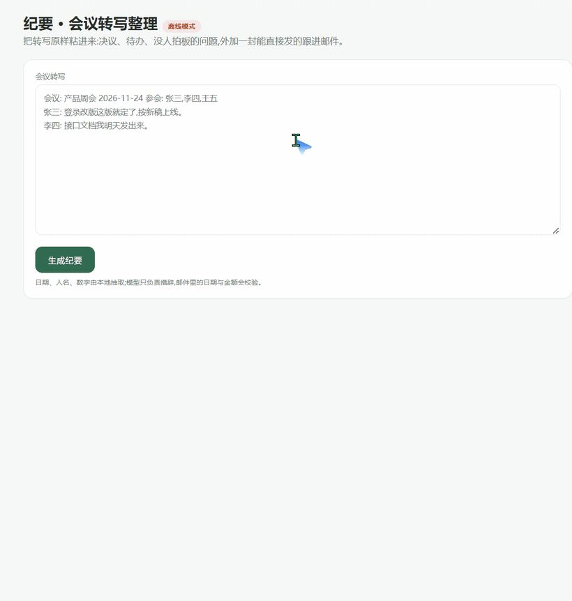
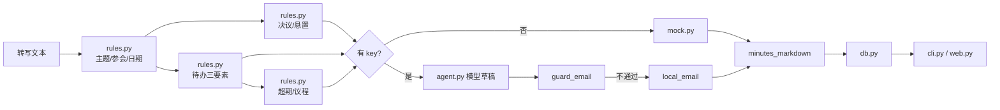

# 纪要 · 会议转写整理

[](https://github.com/wushiyi105-jpg/jiyao/actions) []() [](./LICENSE) [](https://codecov.io/gh/wushiyi105-jpg/jiyao)



> 把会议转写粘进来:拿走决议、待办、没人认领的问题,外加一封能直接发的跟进邮件。

转写工具都能出文字,但没人愿意从两小时的口语里挑「哪些算定了」「谁答应了什么」「哪个问题又被跳过了」。这个工具把这些变成结构化输出:每条决议挂着发言原文,每条待办校验负责人、截止、动作三项,缺一项标黄;含糊词和不完整的待办自动进下次议程。

**CLI + Web,零第三方依赖。**

## ✨ 特性

- ✅ **决议 vs 讨论** — 命中「定了 / 拍板 / 通过 / 同意」且不含「待定 / 下次再说」的句子才算决议,每条带发言人
- 📌 **待办三要素校验** — 动作、负责人、截止、依赖;缺哪项就标「缺截止」,不装作完整
- ⏳ **悬置问题单列** — 「下次再说」「再看看」「没有结论」自动收进悬置清单,并改写成待决问题
- 🟡 **含糊词统计** — 「尽快」「回头」「看看」「之后」逐词计数,含糊就等于没有截止
- 🗓 **下次议程自动生成** — 悬置问题 + 超期待办 + 缺截止待办,按类型排好
- 📄 **跟进邮件** — 结论、待办表、需下次明确项;模型写的稿子要过日期与数字校验,通不过就用本地模板
- 🧮 **日期本地解析** — `2026-11-24`、`11月24日`、`明天`、`本周五`、`下周三`、`月底` 都算得出具体日期
- 🔒 **模型不改数字** — 邮件里的日期与金额必须来自转写原文,新造一个就整封退回

## 🚀 快速开始

```bash
git clone https://github.com/wushiyi105-jpg/jiyao.git
cd jiyao

cp .env.example .env      # 可选:LLM_API_KEY

python -m jiyao minutes --file transcript.txt
```

转写格式不讲究,`姓名: 内容` 一行一句就行;带时间戳的 `[00:12] 张三: …` 也能认。

Docker:

```bash
docker build -t jiyao .
docker run -p 8000:8000 jiyao
```

## 🤔 为什么不用通用大模型直接问

通用模型会给你一段「本次会议讨论了登录改版、接口文档与埋点方案」的漂亮话,但不会告诉你李四的待办没有截止时间。差别在四点:

1. **日期是算出来的,不是猜的** — `rules.dates_in()` 把「明天」映射成 `2026-11-25`(基准是会议日期,不是今天),「本周五」按周一起算,「月底」取当月最后一天。模型经常把相对时间按「现在」换算,纪要里的截止就整体错一周。
2. **待办完整性是校验出来的** — 「接口文档我明天发出来」有动作(发)、有负责人(李四)、有截止(2026-11-25),三项齐,标 ✅;「数据看板尽快看一下」只有动作和人,缺截止,标 ⚠️ 缺 截止,并进入下次议程。这是 `rules.todos()` 的 `missing` 字段,不是措辞。
3. **含糊词有账可查** — 「尽快」出现 1 次、「再说」1 次,`rules.vague_hits()` 直接计数。含糊词不是语气问题,是排期风险。
4. **邮件不许编** — 模型写邮件可以,但 `agent.guard_email()` 会把邮件里的每个日期与数字和本地抽取结果比对,出现未授权的 `2026-12-01` 或 `8800`,整封退回本地模板重写。金额与日期不会因为模型幻觉而变。

## 🎯 适用场景

- **周会**:一小时会、十条待办,散会后五分钟出纪要,谁没截止一眼看到。
- **评审**:结论与遗留问题分开,未通过项落到人。
- **复盘**:目标、结果、问题、改进项,避免开成吐槽会。
- **客户沟通**:客户诉求与我方答复分列,待办与需客户确认项分开。
- **跨时区/远程**:转写直接粘,不用回听录音。

## 🗺 Roadmap

- **多文件合并**:一次会议多段转写按时间戳拼接,自动去重。
- **说话人纠正**:转写把两个人认成一个人时,支持一次性改名并同步全部引用。
- **待办状态回写**:`done` / `blocked` 标记,历史里看某人的未结项。
- **日历导出**:截止时间生成 `.ics`,直接进日历。
- **模板自定义**:从 `data/meeting.json` 派生自己的周会/评审模板。

## ❓ FAQ

**转写是口语,断句都没有怎么办?**
按 `[。！？；\n]` 切句,再按发言人行归属。没有发言人的整段文本也能处理,只是负责人识别会弱一些,`--participants` 可以补名单。

**模型会不会把「明天」算错?**
不会。相对日期全部由本地按会议日期换算,模型拿到的是已经算好的 `2026-11-25`,而且邮件里的日期还要过校验。

**「下周再说」算待办还是悬置?**
悬置。命中悬置词就不进待办表,避免出现一条永远没有截止的「待办」。

**能识别金额吗?**
能抽取(`rules.numbers()`),但只用于校验模型是否新造数字;本工具不做费用核算。

**离线模式缺什么?**
只缺摘要与执行提示的措辞,决议、待办、悬置、议程、邮件正文全部照出,结构完全一致。

## 📖 命令参考

```bash
# 📝 完整纪要
python -m jiyao minutes --file transcript.txt
python -m jiyao minutes --text "张三: 接口文档我明天发出来。" --topic "产品周会" --date 2026-11-24

# 📌 只看待办
python -m jiyao todos --file transcript.txt

# 📄 只要邮件
python -m jiyao email --file transcript.txt

# 🗓 只要议程
python -m jiyao agenda --file transcript.txt

# 🗂 历史
python -m jiyao history

# 🌐 Web
python -m jiyao web --port 8000

python -m jiyao --json minutes --file transcript.txt
python -m jiyao --mock minutes --file transcript.txt
```

## 🔌 模型接入

兼容 **OpenAI `/chat/completions`** 的任意服务:

| 平台 | `LLM_BASE_URL` | `LLM_MODEL` |
|---|---|---|
| DeepSeek(默认) | `https://api.deepseek.com` | `deepseek-flash` |
| OpenAI | `https://api.openai.com/v1` | `gpt-4o-mini` |
| 本地 Ollama | `http://localhost:11434/v1` | `qwen2.5` |

## 🧠 工作原理

```
转写 + 主题 + 参会人 + 会议日期
  │
  ├─ rules.parse_header ── 主题 / 参会 / 日期
  ├─ rules.people ─────── 发言人 + 名单对齐
  ├─ rules.dates_in ───── 相对日期 → 具体日期
  ├─ rules.decisions ──── 决议(排除悬置词)
  ├─ rules.suspended ──── 悬置问题
  ├─ rules.todos ──────── 动作 / 负责人 / 截止 / 依赖 / 缺失项
  ├─ rules.overdue ────── 超期
  ├─ rules.agenda ─────── 悬置 + 超期 + 缺截止
  │
  ├─ 模型:摘要 / 执行提示 / 风险 / 邮件(guard_email 校验)
  └─ 离线:mock.py 同结构草稿 + 本地邮件
  │
  └─ SQLite → CLI / Web
```

### 数据流



## 🗂 目录结构

```
jiyao/
├── jiyao/
│   ├── rules.py    # 日期、人名、决议、悬置、待办、议程、Markdown
│   ├── agent.py    # 编排 + 邮件日期/数字校验
│   ├── mock.py     # 离线同结构草稿
│   ├── db.py       # 会议与待办
│   ├── cli.py      # minutes / todos / email / agenda / history / web
│   └── web.py      # 单页 + JSON API
├── data/meeting.json   # 4 类模板 + 动词表 + 含糊词 + 标记词
├── tests/test_jiyao.py
└── assets/demo.gif
```

## ✅ 测试

```bash
python -m unittest discover tests -v
```

28 个单测:表头解析、说话人、五种日期表达、决议与悬置召回、待办完整性、依赖、含糊词、超期、议程、模板匹配、Markdown 分节、离线结构、邮件校验拒绝编造日期与金额。CI 在 3.10/3.11/3.12 上跑。

## 👤 作者

罗之之 · 15071889700

## 📄 License

[MIT](./LICENSE)
