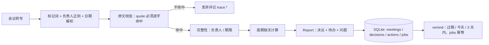

# jiyao · 会议纪要与决议追踪


会开完了，谁答应了什么、什么时候交、有没有交——一条都不许丢。

## 功能特性

- **原文回链**：每条决议与待办都带原文片段和字符位置，`trace.decision` / `trace.action` 校验不过就丢弃
- **三类分离**：决议、待办、悬置问题分开输出，待办带负责人与期限
- **完整性校验**：缺负责人出 `action.no_owner`，缺期限出 `action.no_due`，都不拦着入库，但会标出来
- **逾期追踪**：到期未完成按天算逾期，超过 7 天 severity=high
- **每日提醒**：`remind` 把过期 / 今天到期 / 3 天内到期汇总成一段，`jobs` 表按 key 幂等，同一天只发一条
- **离线可用**：没有 API key 时全靠规则抽取；有 key 时模型补隐含待办，仍然要过原文校验

## 快速开始

```bash
uv sync --extra dev
uv run jiyao digest --file meeting.txt --save --title "支付评审"
uv run jiyao actions
uv run jiyao remind
uv run jiyao serve        # http://127.0.0.1:8021
```

实测这段转写（"主持人：把支付流程定了…小李：我负责下周三把验证脚本写完…"）抽到 1 条决议、1 条待办，负责人小李，期限 2026-12-02（当天是 11-27 周五，"下周三"）。
本仓 31 条测试，行覆盖 80%。

## 为什么不用通用大模型直接问

把转写丢给通用模型也能出纪要，但它：

1. **不保证原文**——它会改写、合并，甚至编一句"大家一致同意"；
2. **不跟踪**——出完就完了，下周没人知道那件事做没做；
3. **不标缺项**——待办没写负责人，它不会提醒你"这条没人认领"；
4. **不会自己想起**——没有到期提醒，逾期也没人管。

jiyao 里每条决议和待办必须能在转写里逐字找到，找不到就丢；跟踪、逾期、提醒都在本地代码里。

## 适用场景

- 每周开 3 场以上会的人；
- 需要把会议结论发给别人、还要被追问进度的人；
- 带项目、要追交付日期的人。

## Roadmap

- [ ] 决议之间的依赖关系（A 没做完，B 不能开始）
- [ ] 多会议串联：同一件事跨周追踪，自动合并
- [ ] 从日历读取会议标题与参会人，减少手填
- [ ] 导出 markdown 周报

## FAQ

**问：抽漏了怎么办？**
规则只认标记词（"定了/确认/决定"）和明确的负责人+日期句式。漏了要么把话说全，要么开模型补，但补出来的仍然要过原文校验——宁可漏，不可编。

**问：`remind` 会不会重复发？**
不会。key 是 `remind:日期`，写进 `jobs` 表，第二次运行直接返回"已提醒过"；确实要重发加 `--force`。

**问：旧版 0.x 的库能迁吗？**
`jiyao migrate --db data/jiyao.db`：先备份成 `jiyao.bak-时间戳.db`，把旧的 `meetings.topic` / `todos` 转成新表，认不出的结构退出码 2，原文件不动。

**问：没有 API key 能用吗？**
能。digest / actions / remind / serve 全部离线；只有模型补充需要 key，没配就走规则。

## 命令参考

```bash
jiyao digest --file 转写.txt [--text "..."] [--title 标题] [--save] [--json] [--db 路径]
jiyao email --file 转写.txt                  # 生成跟进邮件
jiyao actions [--db 路径]                    # 未完成待办
jiyao done <id> [--db 路径]
jiyao remind [--force] [--db 路径]           # 每日提醒，幂等
jiyao migrate [--db 路径]                    # 0.x 旧库迁移，先备份
jiyao serve [--port 8021] [--db 路径]
jiyao doctor [--db 路径]                     # 配置 / 数据库 / 模型 / webhook
```

## 依赖说明

运行时：`fastapi`、`uvicorn`、`jinja2`、`python-multipart`、`pydantic` + `pydantic-settings`（前缀 `JY_`）、`httpx`、`typer` + `rich`、`sqlalchemy` + `alembic`。
开发：`pytest`、`pytest-cov`、`ruff`（line-length 100）、`mypy`。
Python ≥3.10；镜像 `python:3.10-slim`，两阶段，`EXPOSE 8021`。

## 工作原理



规则全在 `domain/rules/`，存储与迁移在 `adapters/`，CLI/Web 只展示。

## 目录结构

```
jiyao/
├── jiyao/
│   ├── domain/          # models、engine、rules/{extract,track}、remind
│   ├── adapters/        # store.py（SQLAlchemy）、migrate.py、llm.py
│   ├── iface/           # cli.py（Typer）、web.py（FastAPI + Jinja2）
│   ├── config.py        # JY_ 前缀配置
│   └── doctor.py
├── migrations/          # alembic env + versions/0001_init.py
├── prompts/extract.md   # 模型补充抽取的提示词
├── templates/
├── tests/               # 26 条：抽取 / 校验 / 提醒 / 迁移 / 接口
├── Dockerfile           # python:3.10-slim，EXPOSE 8021
└── .github/workflows/test.yml
```

## 质量与供应链

- CI 的 Coverage 步骤带 `--fail-under=70`，覆盖率低于 70% 直接失败。
- `tests/test_app_fake.py` 用真实 `InMemoryStore` 跑主用例，并显式标注 `StorePort` 交给 mypy 做结构校验；测试不创建 SQLite 文件。
- Audit 步骤从 `uv.lock` 导出运行时依赖，再用 `pip-audit -r` 审计；开发工具链不进发布物，运行时依赖有漏洞就让 job 失败，不用 `|| true` 吞错。

## 作者

罗之之 · GitHub [@wushiyi105-jpg](https://github.com/wushiyi105-jpg) · 15071889700
